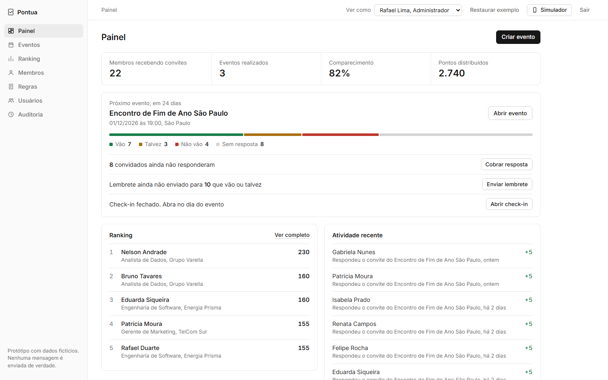
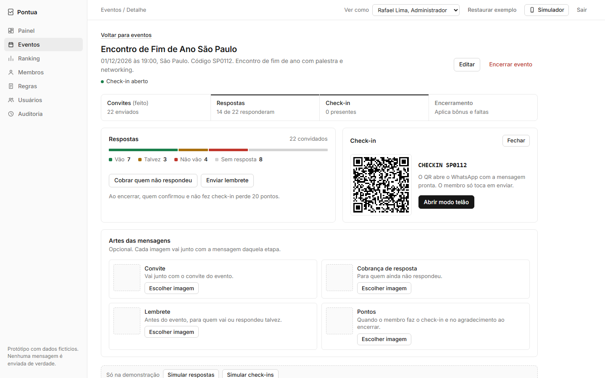
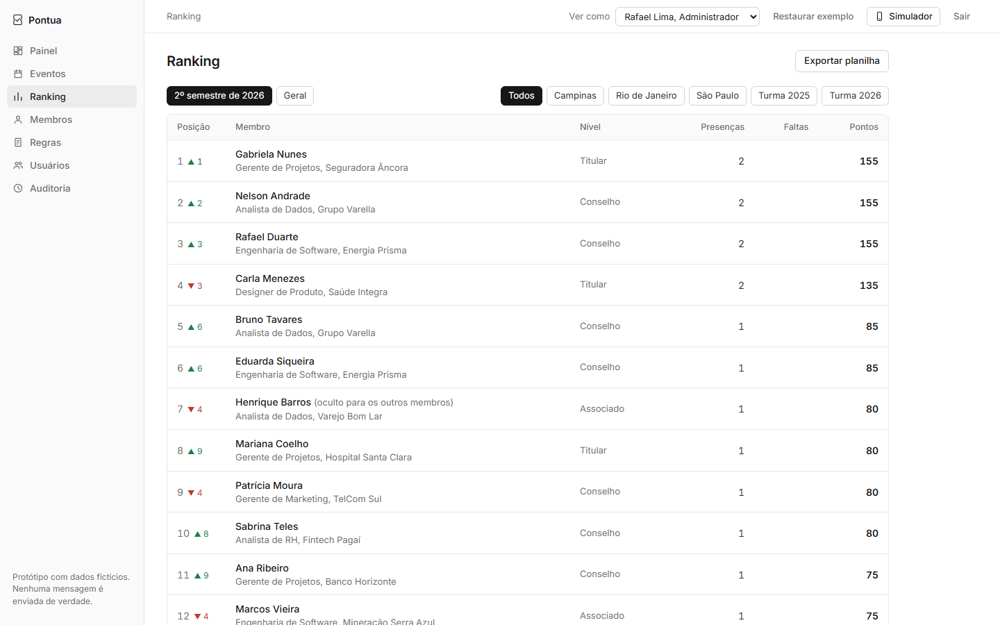
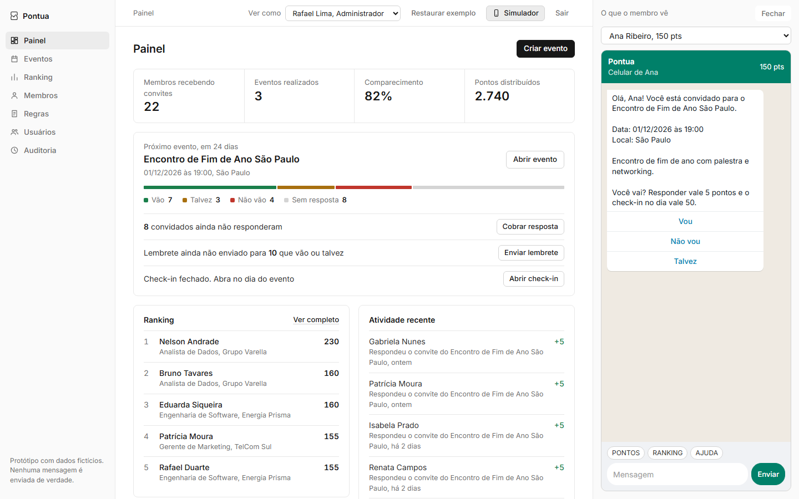
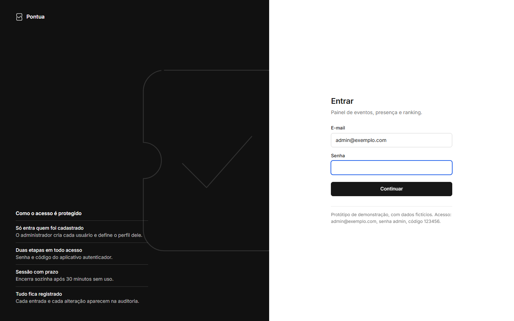
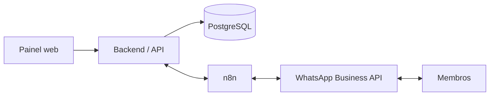

# Pontua

**Eventos com convite pelo WhatsApp, check-in por QR code e ranking de pontos.**

Para quem organiza eventos recorrentes (meetups, cursos, associações, comunidades, igrejas, academias) e quer saber de verdade quem vai, quem foi e quem mais participa, sem planilha e sem cobrar resposta um por um.



> **Status:** protótipo navegável completo, com regras de pontuação, modelo de dados e arquitetura definidos. Backend e integração real com o WhatsApp em construção (ver [Roadmap](#roadmap)).

## Testar agora

Abra `prototipo/index.html` no navegador (no Windows, dois cliques em `abrir-prototipo.bat`). Não precisa instalar nada. Se o repositório estiver com o GitHub Pages ligado, o protótipo também abre pelo link do Pages.

| E-mail | Senha | Código |
|---|---|---|
| admin@exemplo.com | admin | 123456 |

Acesso fixo de demonstração. Todos os nomes, telefones e dados são fictícios e nenhuma mensagem é enviada de verdade.

## Como funciona

1. **Cria o evento** no painel: nome, data, local, vagas e uma arte opcional para cada mensagem.
2. **Escolhe quem recebe**, por filtro (turma, cidade, busca) ou um a um.
3. **O convite chega no WhatsApp** com os botões Vou, Não vou e Talvez. As respostas aparecem no painel na hora.
4. **Cobra e lembra** quem não respondeu, manualmente ou 24h antes, de forma automática.
5. **Check-in no dia:** um QR code na entrada abre o WhatsApp com `CHECKIN <codigo>`. Funciona também em tela cheia (modo telão).
6. **Encerra o evento:** quem confirmou e faltou perde pontos, e o ranking se atualiza.
7. **O membro consulta** mandando `PONTOS` ou `RANKING` no WhatsApp.

## Telas

| Evento com check-in aberto | Ranking |
|---|---|
|  |  |

| Simulador do WhatsApp | Entrada com duas etapas |
|---|---|
|  |  |

## Regras de pontuação

| Ação | Pontos |
|---|---|
| Responder o convite (vou, não vou ou talvez) | +5 |
| Check-in no evento | +50 |
| Bônus: confirmou e compareceu | +20 |
| Confirmou e não fez check-in | -20 |

Confirmar presença sozinho não dá ponto. Se desse, as pessoas clicariam em Vou só pelo ranking e a lista de presença deixaria de ser confiável.
O saldo é sempre a soma de um livro de lançamentos e nunca um campo editado. Correção manual entra como ajuste, com motivo.
Detalhes, comandos e janela de check-in em [docs/regras-pontuacao.md](docs/regras-pontuacao.md).

## Arquitetura



- **PostgreSQL** é a fonte oficial dos dados. Toda regra de pontos mora no backend.
- **n8n** só orquestra: disparo de convites, lembretes e recebimento de webhooks. Não guarda estado.
- **WhatsApp** pela API oficial da Meta. Alternativas e riscos em [docs/whatsapp.md](docs/whatsapp.md).

Mais em [docs/arquitetura.md](docs/arquitetura.md) e [docs/seguranca.md](docs/seguranca.md).

## Banco de dados local

Com Docker instalado:

```bash
cp .env.example .env
docker compose up -d
docker compose exec db psql -U pontua -c "select * from ranking"
```

Sobe o PostgreSQL 16 com [db/schema.sql](db/schema.sql) e os dados de exemplo de [db/seed.sql](db/seed.sql), que cobrem todos os casos das regras (confirmou e foi, confirmou e faltou, talvez e foi, recusou, ajuste manual).

## Estrutura

```
prototipo/          protótipo navegável (HTML único)
docs/               escopo, regras, arquitetura, WhatsApp, segurança
db/schema.sql       modelo de dados (PostgreSQL)
db/seed.sql         dados de exemplo
docker-compose.yml  banco local
backend/            a construir
frontend/           a construir
n8n/                fluxos do n8n (a construir)
```

## Roadmap

- [x] Protótipo navegável com todas as telas e fluxos
- [x] Regras de pontuação e comandos do WhatsApp
- [x] Modelo de dados e banco local com dados de exemplo
- [ ] Backend (API, regras de pontos, autenticação com autenticador)
- [ ] Integração com a API oficial do WhatsApp
- [ ] Fluxos do n8n: disparo, lembrete 24h antes, abrir e fechar check-in
- [ ] Painel web ligado ao backend
- [ ] Importação de membros por planilha
- [ ] Deploy com HTTPS, backup e monitoramento

## Licença

Todos os direitos reservados. O código está público apenas para consulta e demonstração. Uso, cópia ou venda só com autorização do autor. Ver [LICENSE](LICENSE).
